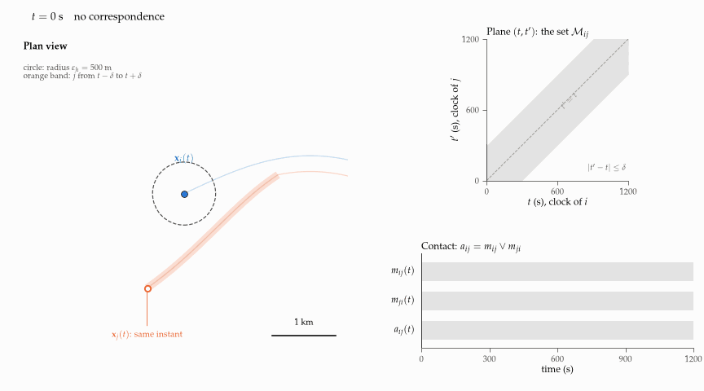
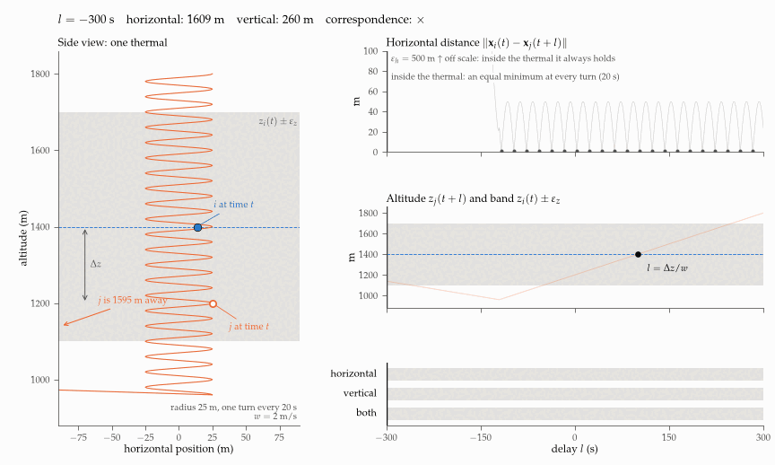
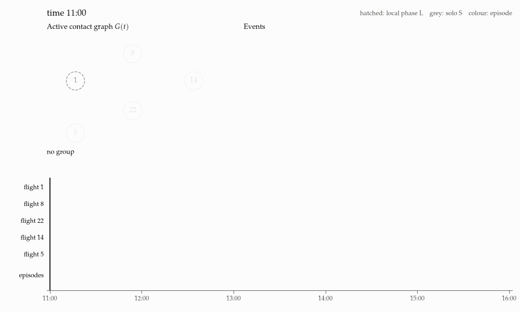

# Group identification

**Status:** method note, run on all the cleaned flights of the old repository with tuned
parameters (δ = 2 min, q = 0.1). Started 2026-10-14, updated 2026-10-23.

**Question.** How do we tell, at every instant of every flight, whether a pilot flies in a
group, and with whom?

**Answer.** Two pilots are in contact when one of them is on the path of the other within
δ = 2 min, 500 m horizontally and 300 m vertically (headings compared only in glide) for at
least τ* = 38.1 min, the duration at which the time-shift null model explains at most 10% of
the contacts; the groups of an instant are the connected components of the contact graph.
Then 21.7% of the paraglider and 6.9% of the hang-glider flights fly in a group at some point,
in 17 169 episodes. Why these values, what chance means and how real pairs differ from it:
sections 5–6 of `group_identification.pdf`. Why `m_ij(t) = 1` does not give
`m_ji(t) = 1`, with a worked example: the appendix of `group_identification.pdf`.

**Data and code version.** The cleaned tracks and the Vilpellet phases that soaring (tag
`legacy-final`) wrote on SSD_DISANTE, not the pre-processing of xc-dynamics that the note
describes; xc-dynamics at `d72e1b9`, not used.

**Results on disk.** Everything is saved in `/Volumes/SSD_DISANTE/xc-lab/group-identification/`,
in folders named by the grouping parameters, each with a `PARAMETERS.md`:

| folder | content |
|---|---|
| `runs/<name>/` | the tables of the note for all dates, `calibration.*`, `episode_distance.parquet`, `days/` (cache per date), `analyses/` (the measured pieces of `analysis/groups/group-identification`, whose figures are in its `out/<run>/`) |
| `runs/d120_eh500_ez300_th45_g120_q0.1/` | the chosen run; `_q0.05` and `_q0.2` beside it share its contacts; `calibration_shifts.json`: τ* by class of surrogate shift |
| `runs/d300_eh500_ez300_th45_g120_q0.05/` | the starting values of the note (δ = 5 min) |
| `delays/sample300_d900_.../` | the delay profile that chose δ |
| `separation/sample300_d120_.../`, `tolerances/sample300_d120_.../` | the distance at the same instant and the profiles of ε_h, ε_z and the gaps, real against chance |
| `trials/sample300/<name>/`, `plateau/sample300.json` | the plateau check |

## Run on the flight data

`run.py` follows the note's algorithm date by date. What the old tracks change:

- **Phase 0.** E, N, z of the cleaned fixes go back to latitude and longitude through the
  inverse of soaring's projection, then to the Earth-centred coordinates of the point at h = 0.
  UTC time = first IGC fix (from the old viewer's index) + trimmed start + t. Departure: the
  first fix farther than 3 km from the first fix. States are Vilpellet's runs, which exist only
  on 1 Hz flights; elsewhere the heading condition is off. Headings come from v_E, v_N.
- **Phase 1.** The old cleaning bounds steps at 45 m/s (para) and 55 m/s (hang), not 100 km/h,
  so the pieces of the filter end at every faster step: the lemma holds on each piece.
- **Phases 2-3.** As in the note; an interval is cut to the time both flights are between
  departure and landing, so that both ends of an edge are nodes of G(t).
- **Null model.** Up to 200 surrogate pairs per date, among the pairs with takeoffs within
  10 km, with |r| ≥ 2δ + Δ. The chance count is summed date by date (ρ0 of the date times its
  H), because the surrogates are a sample of each date.
- **Phase 4.** The sweep recomputes the components at every event.
- Paragliders and hang gliders share one contact graph.

| chosen run (δ = 2 min, q = 0.1) | value |
|---|---|
| flights | 162 485; 160 637 with a logger of at most 10 s and a position after departure |
| raw pair intervals | 728 866; 36 575 last at least τ* |
| τ* | 2 285 s; 2 220–2 465 s (5–95%) over 200 draws of the dates with replacement |
| flights ever in a group | para 33 501 of 154 598 (21.7%), hang 418 of 6 039 (6.9%) |
| f_G | 0.123 |
| configurations, episodes | 40 051, 17 169; episodes of 2 flights (median) to 53, lasting 0.97 h (median) |

The assessment of the method, with its figures, is in sections 5–7 and Appendix H of `group_identification.pdf`: what chance
means (the shifts of the null model, and τ* by class of shift with `shifts.py`: 23 min with
shifts over an hour, 53 min under 30 min), the false discovery rate of the contacts, the delay
profile (`delays.py`), the distance at the same instant (`separation.py`), the profiles of the
tolerances (`tolerances.py`), the plateau check (`plateau.py`) with its table, the choice
of δ and q, and what the groups look like: durations and sizes of the episodes and of the
configurations, by number and by time, for three q.

## Files

- `group_identification.pdf`, built from `group_identification.tex` and `sections/`: the note,
  English version with figures of the Italian note of 14 October 2026. Figures 5, 15 and 30 are
  animated inside the PDF (LaTeX package `animate`): they play in Acrobat Reader and other
  viewers that run PDF JavaScript; elsewhere they show the static figure.
  Sections 5–7 hold the calibration, the tuning on the data and what we find on the archive, the
  appendices the literature, the algorithm and the details; the chosen values sit beside the
  starting ones in the note's table of symbols. The numbers of section 7 are macros that
  `analysis/groups/group-identification`
  writes in its `report/generated/`, and their figures are copies of its `out/<run>/` in
  `figures/structure/`.
- `models.py`: the synthetic scenarios of the figures and the sweep that builds configurations,
  episodes and blocks.
- `plots.py`: writes `figures/` (static figures, and `*_frames.pdf` with `*_frames.tln` for the
  animations in the PDF) and `animations/`.
- `test_note.py`: checks every number the note quotes.
- `assessment.py`: writes `figures/assessment_*.pdf`, the figures of sections 5–7 and Appendix H of the note.
- `grid.py` (Phase 0), `contacts.py` (Phases 1-3 and the null model), `sweep.py` (Phase 4),
  `run.py` (the loop over dates, τ*, the tables of section Outputs, PARAMETERS.md),
  `calibration.py` (the figure and the band of τ*), `delays.py` (the delay profile),
  `separation.py` (the distance at the same instant), `tolerances.py` (the profiles of ε_h,
  ε_z and the gaps), `shifts.py` (τ* with the surrogates of one class of shifts),
  `plateau.py` (the plateau check), `distances.py` (the distance of each episode: the
  longest straight line a member flew in one of its group stretches; the viewer ranks by it),
  `export_viewer.py` (copies one run, with its PARAMETERS.md, to the `groups/` folder of the
  xc-viewer data folder, where the Group flights tab reads it).
- `test_pipeline.py`: Phases 1-3 against every pair of instants on random synthetic days, the
  conditions on synthetic pairs, the sweep against `models.py`, τ*, Phase 0 on one real date.
- `test_results.py`: the numbers of this README; `test_assessment.py`: those of sections 5–7 of
  the note.

## Animations

The contact of a pair: the set of correspondences fills the (t, t′) plane above the diagonal,
because j passes where i was two minutes later.



The vertical condition in a thermal: the horizontal distance is small at every delay, and only
the altitude selects one window of delays, so pilots at distant heights are not in contact. Inside
the window every turn gives an equal minimum, so the delay l* stays undetermined.



An example day: the contact graph, the configurations c1–c4 and the episodes E1, E2, event by
event.



## Rebuild

```
uv run python plots.py                       # from this folder; needs LaTeX and ImageMagick
latexmk -pdf group_identification.tex
uv run python run.py --jobs 5 --set delta=120,q=0.1   # needs SSD_DISANTE; about 1 h, resumable
uv run python run.py --set delta=120,q=0.2 --days <runs>/d120_..._q0.1/days   # another q: minutes
uv run python calibration.py <run folder>    # the figure and the band of τ*, about 1 min
uv run python distances.py <run folder>      # about 3 min
uv run python export_viewer.py <run name>    # to /Volumes/SSD_DATA/xc-viewer-data/groups
uv run python delays.py --sample 300 --delta 900     # about 30 min
uv run python plateau.py --sample 300        # about 1 h
uv run python separation.py --sample 300
uv run python tolerances.py --sample 300
uv run python shifts.py                      # after run.py on the chosen run; about 20 s
uv run python assessment.py && latexmk -pdf group_identification.tex   # figures of sections 5-7
cp ../../analysis/groups/group-identification/out/d120_eh500_ez300_th45_g120_q0.1/{mechanisms_phases,mechanisms_hours,cohesion,chains,hierarchy,mechanisms_habitual,partners,fission}.pdf figures/structure/   # section 7, after the analyses
uv run pytest ideas/group-identification     # from the root of xc-lab
```

`uv run python plots.py --static` skips the GIFs. `run.py --sample N` or `--dates D1,D2` runs a
trial into `trials/`; `--out DIR` writes elsewhere.
