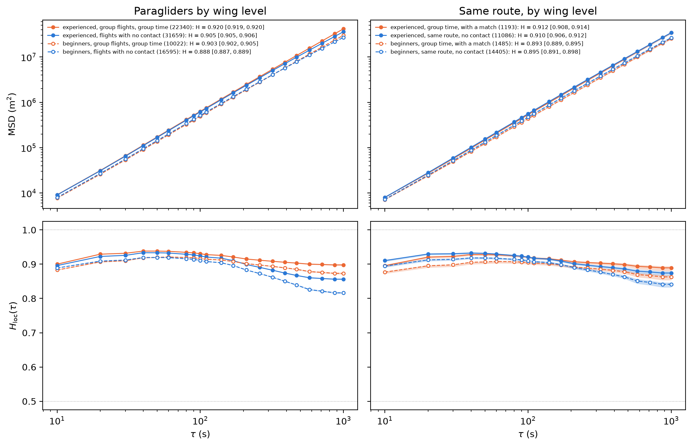
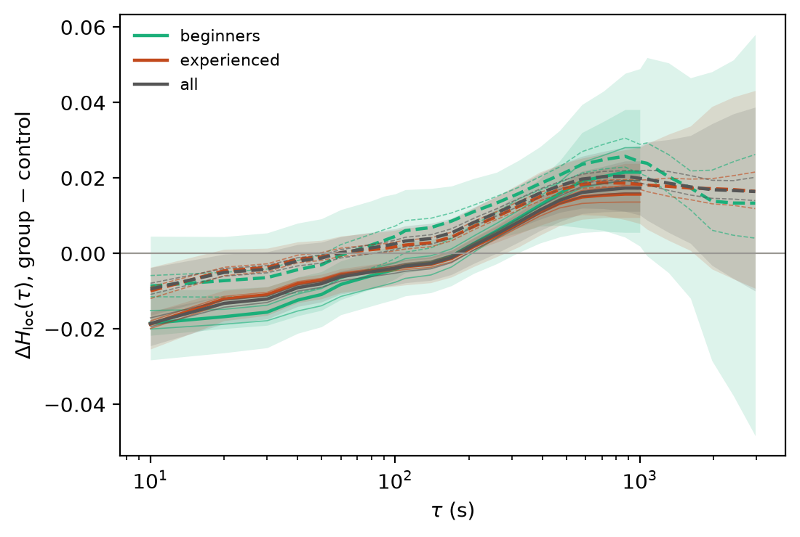
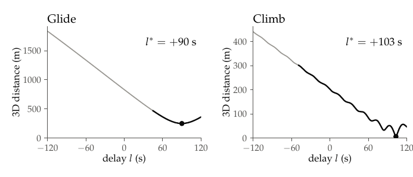
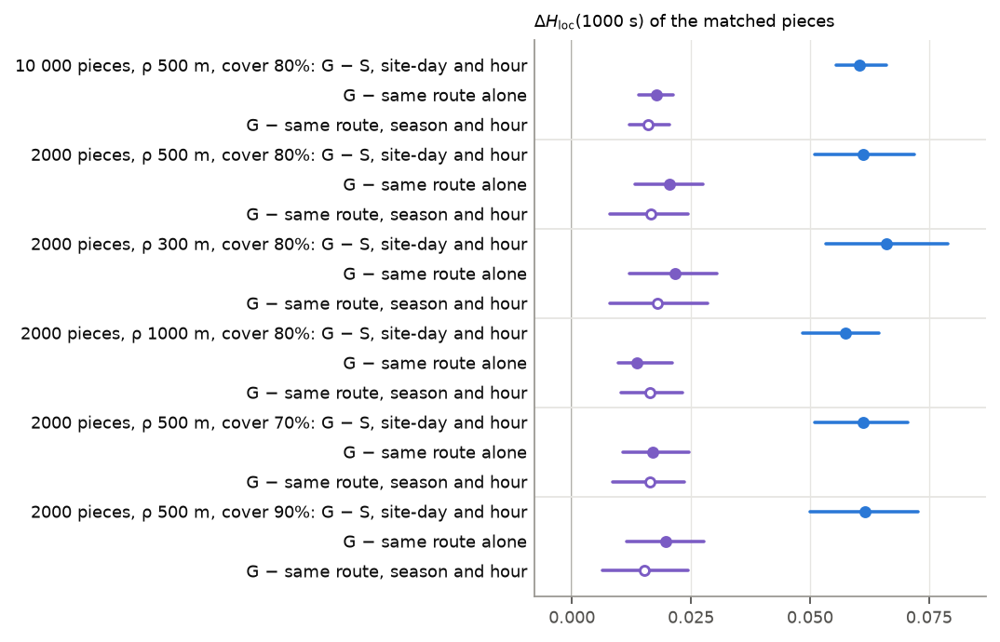
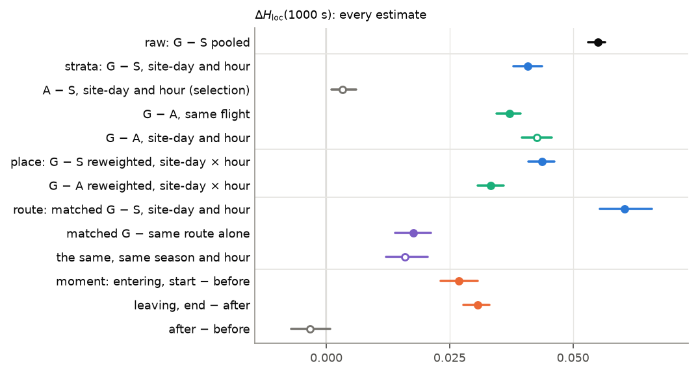
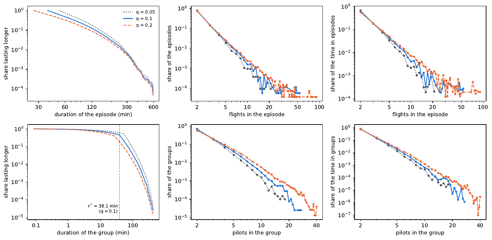
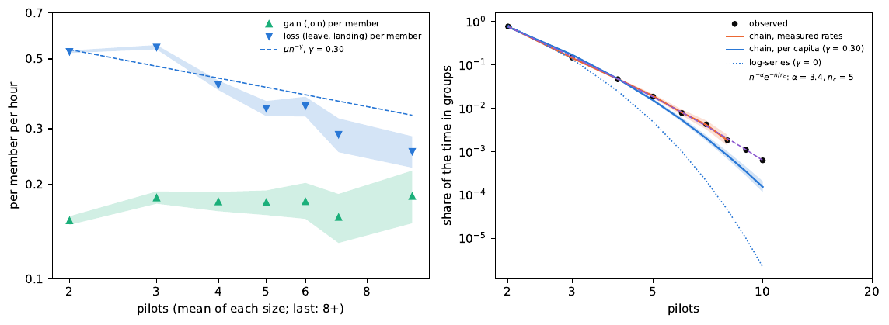
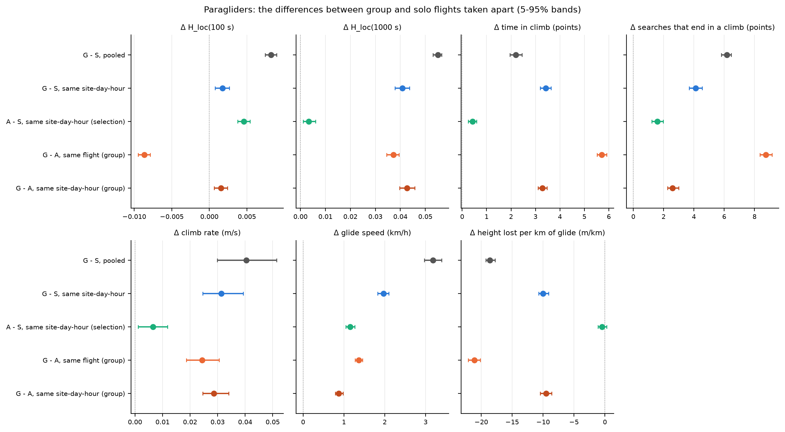
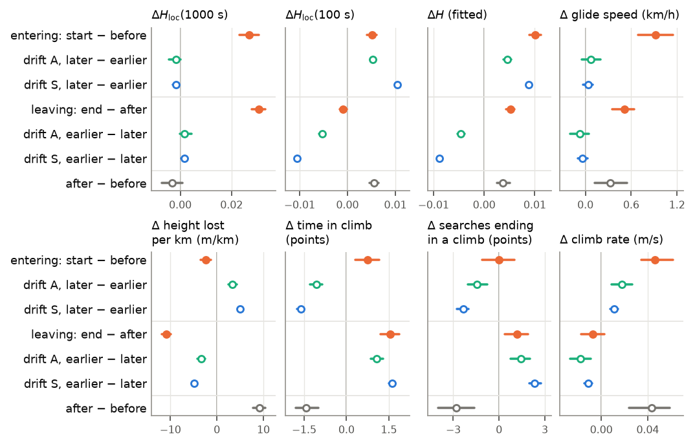
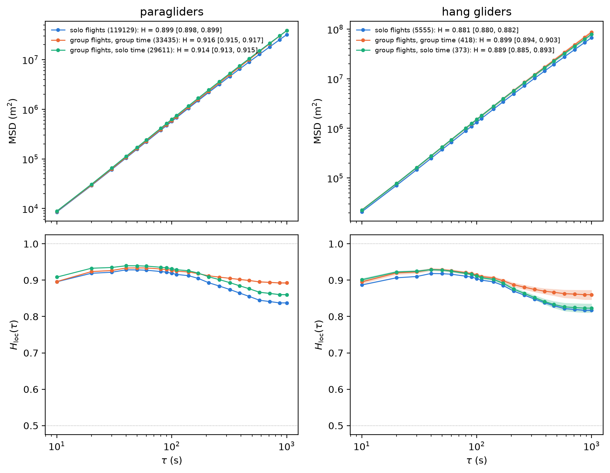

# Logbook · ottobre 2026

Le voci dal 14 al 27 ottobre sono ricostruite il 29 dai commit; le loro figure sono le versioni del 29.

## 2026-10-29 gio · gruppi, lab

- **Fatto:** analisi per livello di vela in `analysis/groups/experienced/` (esperti C, D, CCC; principianti A, B): conteggi, glide ratio, TA-MSD, durate delle fasi con fit di più famiglie (Lomax, gamma, Weibull, lognormale, …).
- **Fatto:** `isolated.py`: la differenza tra tempo in gruppo e voli davvero soli (nessuno entro 10 km nello stesso minuto) sulla stessa rotta, in altri giorni, a parità di stagione, ora e livello.
- **Fatto:** la sezione "What we find" della nota sul metodo diventa la nota `analysis/groups/group-structure/`; la nota sul metodo resta il metodo.
- **Fatto:** proposta di riordino di xc-lab (`methods/`, `analyses/`, `common/`); si inizia questo logbook.
- **Trovato:** sulla stessa rotta H non distingue gruppo e solo; a 1000 s il gruppo resta più dritto a entrambi i livelli.

| | gruppo | senza contatti | gruppo, con match | stessa rotta, solo |
|---|---|---|---|---|
| esperti, H | 0.920 | 0.905 | 0.912 | 0.910 |
| principianti, H | 0.903 | 0.888 | 0.893 | 0.895 |
| esperti, glide ratio | 13.0 | 10.2 | | |
| principianti, glide ratio | 12.4 | 8.9 | | |

- **Trovato:** run completo di `isolated.py` (24 min, 2.0 GB): contro voli davvero soli sulla stessa rotta il divario di H_loc a 1000 s scende da 0.058 a 0.017; si spiega il 70% (esperti 69%, principianti 68%), come con `route.py` (71%). Il 30% che resta va con il volo in gruppo. Ai lag brevi il gruppo è meno balistico del controllo (ΔH_loc ≈ −0.02 a 10 s).

| ΔH_loc(1000 s) | pezzi | contro solo, stesso site-day e ora | contro stessa rotta, voli isolati | spiegato |
|---|---|---|---|---|
| esperti | 10 824 | 0.051 | 0.016 | 69% |
| principianti | 4 715 | 0.068 | 0.022 | 68% |
| tutti | 15 539 | 0.058 | 0.017 | 70% |

- **Non va:** `matches()` di `isolated.py` cercava controlli nello stesso giorno e ne trovava 5: riscritto su altri giorni (`isolated_plan.md`).
- **Fatto:** riordino di xc-lab: `ideas/` → `methods/`, `lab/` + `tests/` → `common/`, `analysis/` → `analyses/`; gli script dei gruppi in un'unica cartella `analyses/groups/` (sono una catena che si importa a vicenda), con le domande divise nei documenti: `vs-solo/` (report gruppo/solo, ex `report/`) e `structure/` (nota sulla struttura). Solo percorsi: test uguali prima e dopo (181 passano).
- **Non va:** `methods/phase-labelling/test_note.py::test_same_labels_as_the_reference_script_on_three_flights` fallisce già prima del riordino: chiama il preprocessing di xc-dynamics con la vecchia forma della config `airborne` (`'float' object is not subscriptable`).
- **Non va:** il README di xc-viewer cita ancora `ideas/group-identification`: da correggere in una sessione del viewer.
- **Prossimo:** compilare le due note sui gruppi; decidere se accorciare il README di `analyses/groups` (587 righe di risultati per script, in buona parte già nei due documenti); sistemare il test di phase-labelling.
- **Rif.:** nota struttura `b4d74a2`, livelli di vela `5f95d32`, isolated `b3205c2`, logbook `28aaa04`, riordino `54303b0`, `4ed0587`, `f14de3d`, `63ce945`.

## 2026-10-27 mar · gruppi, slides

- **Fatto:** figure dei ritardi e della separazione con testo grande per le slides; slides dei parametri riordinate (q prima dello shift, tolleranze tolte).
- **Rif.:** `6f34b96`, `37e675a`.

## 2026-10-26 lun · gruppi

- **Fatto:** il ritardo ℓ* ora minimizza la distanza 3D, non quella orizzontale; rifatte `cohesion`, `hierarchy`, `mechanisms` e il run con δ = 5 min. Talk sul viewer.
- **Trovato:** in termica la distanza orizzontale ha un minimo uguale a ogni giro, quindi il ritardo cadeva su un giro qualsiasi; con la 3D l'altitudine sceglie il giro.
- **Trovato:** contatti, gruppi ed episodi identici; il ritardo cambia nel 51% degli intervalli di coppia, il segno nell'1.7%. Il ritardo si dimentica in 4.7 min nei gruppi, 4.8 min per caso.

- **Rif.:** codice `0e60070`, analisi rifatte `9c0b064`, nota `ebd76e5`, talk viewer `23d12f3`.

## 2026-10-25 dom · gruppi

- **Fatto:** nomi scambiati: *configurazione* = alianti collegati a un istante, con i loro link; *gruppo* = stessi membri su un intervallo massimo (la vecchia configurazione). Nuove tabelle `groups.parquet`, `configurations.parquet`; run ricalcolato dalla cache; slides riviste.
- **Trovato:** 52 856 configurazioni in 40 051 gruppi; gruppi, episodi e τ* invariati.
- **Rif.:** `22c9193`, `d6cf43a`, `791c5ce`.

## 2026-10-24 sab · gruppi vs solo

- **Fatto:** revisione indipendente del report `group_vs_solo`; test della rotta (`route.py`): pezzi di tempo in gruppo contro voli senza contatti, stesso sito, altri giorni, stessa rotta nello stesso verso.
- **Trovato:** la rotta spiega circa il 70% del divario a lunghi lag (71%, 74%), stabile su raggi 300–1000 m e coperture 70–90%.

- **Fatto:** le figure del report mettono ogni stima del divario a 1000 s su un asse.

- **Non va:** la revisione trovava affermazioni non sostenute: la selezione contata nell'effetto gruppo; luogo e ora spiegano da 1/5 a 1/4 del divario, non "al più 1/5"; uscita dal gruppo letta con il segno sbagliato (le salite passano solo metà del test prima/dopo). Zone e rotta erano confrontate con la baseline sbagliata. Corretto.
- **Rif.:** route `7924bb1`, revisione `c44a8d2`, report `7c9854e`, `458c42f`, `f57741c`.

## 2026-10-23 ven · gruppi, meeting

- **Fatto:** sei analisi di struttura (`describe`, `cohesion`, `chains`, `hierarchy`, `partners`, `fission`); nota sul metodo riscritta più volte (assessment fuso dentro, introduzione sulle tre difficoltà); due mazzi di slides per il meeting del 23.
- **Trovato:** i piloti in gruppo tengono lo stesso passo, non c'è una molla che li richiama; i gruppi grandi sono stringhe lungo la rotta; la distribuzione delle taglie segue da un pilota alla volta, la coda pesante da chi è in gruppi grandi che se ne va meno.
- **Trovato:** ritardo mediano dei contatti lunghi 25 s. τ* dipende dallo shift dei surrogati: 23 min con shift oltre un'ora, 53 min sotto i 30 min.

- **Non va:** la nota raccomandava lo shift minimo, il codice usa shift di circa un'ora: la nota ora dice quelli usati. La baseline "2 MSD" ignorava la deriva comune: sostituita con le coppie surrogate.
- **Rif.:** analisi `98b8ac6`, τ* e shift `9a146a5`, ritardo mediano `4193ff8`, nota unita `1c8123f`, slides `80974f9`, `2313e2c`.

## 2026-10-22 gio · gruppi vs solo

- **Fatto:** controllo del codice contro la nota, fase per fase; scomposizione della differenza gruppo/solo (`decompose`, `zones`, `size`, `mechanisms`, `redundancy`); report `group_vs_solo.pdf`; test prima/durante/dopo (`prepost.py`).
- **Trovato:** le letture aggregate del tasso di salita e della velocità XC si invertono controllando la composizione.
- **Trovato:** a 1000 s le finestre in gruppo sono più dritte entrando e uscendo (+0.027, +0.031), prima e dopo sono uguali: l'effetto segue il gruppo nel tempo, non è un tratto del pilota o del giorno.

- **Non va:** quattro frasi della nota descrivevano altro dal codice (fasi di Vilpellet su 1 Hz, non HMM; heading nel frame del primo fix; contatto tra il decollo più tardo e l'atterraggio più presto; buchi etichettati solo): segnate in rosso, nessun risultato cambia. Cosa porta i piloti insieme resta non controllato.
- **Rif.:** nota corretta `1a09e22`, scomposizione `29aa1d4`, report `38d1493`, prepost `ec80e4d`.

## 2026-10-21 mer · gruppi

- **Fatto:** il metodo gira su tutti i voli puliti di soaring (`legacy-final`, SSD_DISANTE), un run per cartella di parametri con `PARAMETERS.md`; taratura di δ e q; primo confronto gruppo/solo (TA-MSD, fasi, budget, prestazioni); export al viewer.
- **Trovato:** con i valori iniziali (δ = 5 min) la maggior parte dei contatti era caso e τ* = 89.5 min. Il profilo dei ritardi dà δ = 2 min; con q = 0.1, τ* = 38.1 min. Nessun plateau sulle altre tolleranze: restano definizioni.
- **Trovato:** parapendii, H tra 10 e 1000 s: solo 0.899, gruppo in tempo di gruppo 0.916, stessi voli in tempo solo 0.914: la differenza viene soprattutto dai voli e dai giorni con gruppi. Ai lunghi lag invece conta il gruppo: H_loc(1000 s) 0.893 in gruppo, 0.860 gli stessi voli da soli, 0.837 i voli solo.

- **Rif.:** run `65d8762`, taratura `90b5d4a`, confronto `4ba22e7`, viewer `be4e0ae`.

## 2026-10-20 mar · gruppi, fasi

- **Fatto:** nota sull'identificazione dei gruppi (contatti con ritardo, configurazioni, episodi, null model), con figure su tracce sintetiche; nota sull'etichettatura delle fasi e controllo della cadenza; analisi `phases`: esponenti di coda di Vilpellet e MSD per fase.
- **Trovato:** una spline cubica su griglia di 1 s permette di etichettare logger fino a 5 s; a 10 s no.
- **Non va:** `powerlaw` 2.0 vincola α in [0, 3]: fissato a 1.5.
- **Rif.:** `a49b43c`, `6845e67`, `4aa1b01`.

## 2026-10-14 mer · lab

- **Fatto:** creato xc-lab; il segmentatore di Vilpellet preso da soaring `legacy-final` attraverso `lab/legacy.py`.
- **Rif.:** `e887641`.
