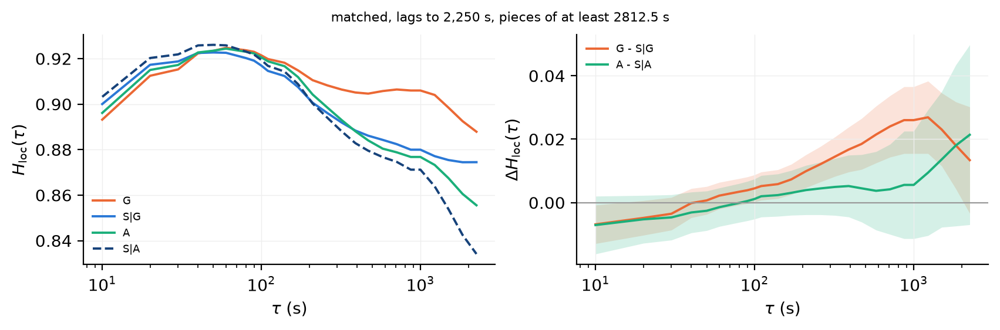
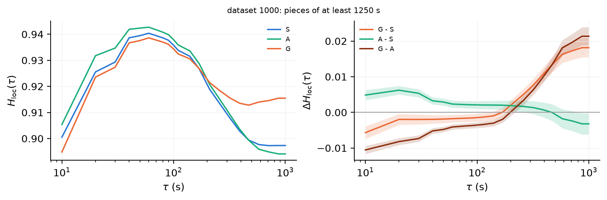
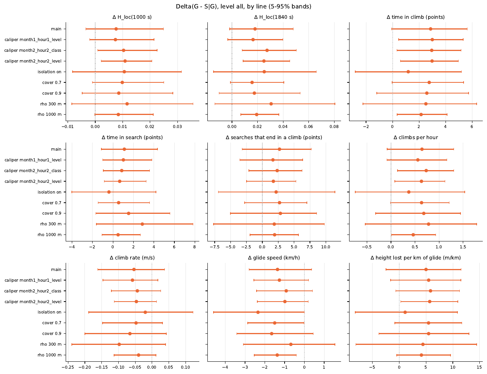
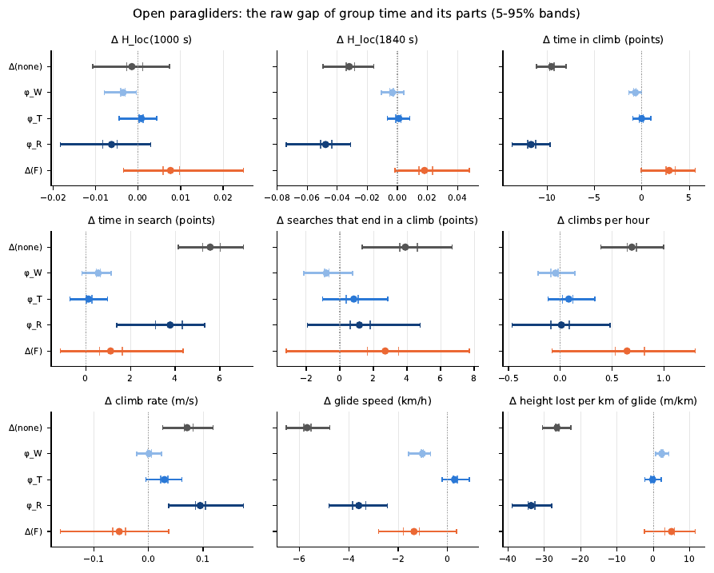
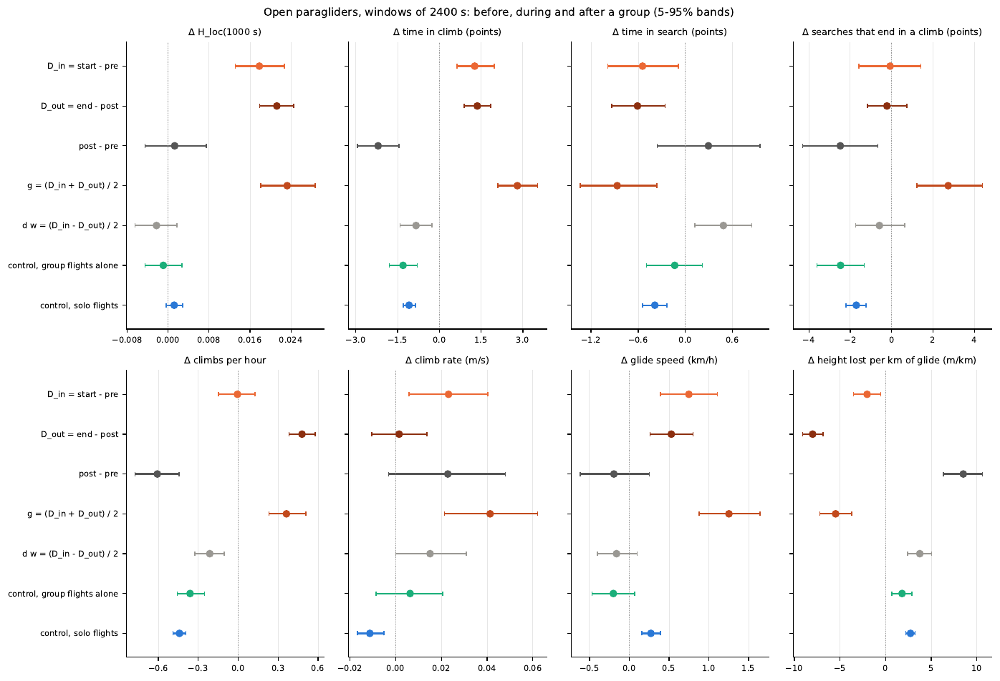

# Logbook · novembre 2026

## 2026-11-14 sab · lettera "Good company is a good route", revisione

- **Fatto:** tolta dalla lettera la survival delle transizioni (figura, tabella, paragrafo): il raw dà una coda più pesante in G, ma same route (non risolto) e same flight (viene dalle transizioni a cavallo dell'inizio o della fine del gruppo) non la confermano; resta solo in S9, ridotta. Titolo "Good company is a good route", autore "Authors", ringraziamenti (FFVL, Chair, uso di Claude).
- **Fatto:** lettera riscritta attorno alla velocità, l'unico risultato che sopravvive ai tre disegni: stessa rotta +1.3 [+0.4, +2.2] km/h netto della selezione (8% dei controlli solitari, nuovo macro `LtRouteXcDiffPct`), dentro il volo +1.0 [+0.2, +1.8]. La persistenza solo nel raw e dentro il volo. Sezioni con domanda in apertura e frase finale; nuova sezione WHERE COMPANY PAYS (terreno); Tabella I spostata in S6.
- **Fatto:** figure. Fig. 2a con due zoom (10-20 s e da 1500 s); forest ora Fig. 4; Fig. 5b fasi al netto delle mock (prima era g senza sottrazione: climb rate risolto in figura e non nel testo); Fig. 5c curva della marcatura m(s) (metà dopo 46 min per i gruppi, 39 per i solitari) al posto del terreno.
- **Fatto:** supplemento: tolte 6 tabelle doppie di figure, paragrafi accorciati, due colonne come la lettera: da 16 a 10 pagine.
- **Trovato:** nella vecchia lettera "the three designs agree" e "gap of similar size while alone" erano falsi (per α sulla stessa rotta la differenza è +0.021 [-0.009, +0.051]; per la velocità A - S|A = 0.0). Sotto qualche minuto di lag i voli che entrano nei gruppi, da soli, sono i più persistenti dei tre.
- **Non va:** velocità contro mock allo stesso sito +0.8 km/h con banda che include 0. Restano i segnaposto: affiliazione, pulizia delle tracce (S1), robustezza (S12).
- **Prossimo:** rilettura dell'autore di lettera e supplemento; testo di S12.

## 2026-11-14 sab · universalità di H, para contro hang

- **Fatto:** nuovo topic `analyses/universality/`: H è universale tra parapendio e deltaplano? Voli dichiarati aperti con apertura > 0.1 (55 879 para, 1 417 hang), pezzi interi sulla griglia a 10 s, nessuna etichetta di gruppo. Classe di terreno dalla mediana della quota del suolo sotto i punti a 10 s (DEM IGN 25 m in blocchi da 200 m; pianura < 300, collina 300-800, bassa montagna 800-1500, alta montagna ≥ 1500; ignoto se meno della metà dei punti è sul DEM). Due disegni: popolazione fissa (T = 1000 s e T massimo con ≥ 100 voli per cella) e tutti i voli; grezzo, per classe e per regione (box del vecchio repo). Bande bootstrap a due vie (piloti × sito-giorno), congiunto tra le discipline. Nota `universality.pdf` (17 pagine), 15 figure, 43 test; cache DEM e pezzi su SSD_DISANTE.
- **Trovato:** a T = 1000 s H para 0.922, hang 0.898, differenza +0.024 [+0.017, +0.031]; positiva in 24 casi su 24 (tutto, 4 classi, Alpi × 4 disegni), tra +0.007 e +0.042, con banda che esclude 0 in 22. Per classe (T = 1000 s): pianura +0.009 [-0.000, +0.018], collina +0.018, bassa montagna +0.027, alta montagna +0.026; Alpi +0.026. Al T massimo del grezzo (11 450 s, 172 hang) +0.007 [-0.006, +0.020]. H cala dalla pianura alla montagna in entrambe (para 0.941 → 0.907, hang 0.932 → 0.880): il divario tra alianti è dello stesso ordine di quello tra terreni. La miscela di terreni non lo spiega. Tutti i voli: H più basso di fino a 0.018 per via della popolazione che si restringe, ΔH invariata entro le bande.
- **Trovato:** nel disegno "tutti i voli" α(τ) sale oltre 3000 s (hang fino a 2.7): è la selezione dei voli lunghi, non fisica. Regioni: solo le Alpi hanno abbastanza hang (842); Pirenei 11, Manica 20, Champagne-Lorena 29 < 30, non adattate. Per i para: Alpi − Manica -0.035, Alpi − Champagne -0.041, Pirenei − Manica -0.045, Alpi − Pirenei +0.010, Manica − Champagne -0.006.
- **Non va:** pochi hang (191 piloti, 28 anche para); perché gli hang stiano sotto non è testato (velocità, uso delle termiche, siti). Il DEM è solo francese: i voli che escono (Svizzera, Italia) perdono punti, 3 296 para e 132 hang ignoti.
- **Prossimo:** rilettura dell'autore; eventuale confronto con soglia di apertura 0.5.

## 2026-11-14 sab · creste, H geometrico e intermittenza

- **Fatto:** nuovo topic `analyses/ridges/`: pipeline DEM → creste → H_geo riscritta da zero dai tre documenti del paper (`paper/`, codice originale perso); giunzioni accettate solo se ogni cella attraversata sta 20 m sopra i torrenti (0 giunzioni su 1 789 Alpi e 705 Pirenei toccano una valle). Voli puliti di anomalous transport (apertura ≥ 0.1, dt ≤ 5 s, ≥ 80% sopra la maschera): 23 320 para Alpi, 2 140 para Pirenei, 784 hang Alpi. Modello: pallina sui percorsi di cresta con glide e pause (search+climb) estratte dalle survival, alla velocità media in planata (para 10.2/10.5 m/s, hang 16.0). Rapporto `crests/crest_geometry.pdf`, 20 pagine.
- **Trovato:** H_geo dei percorsi da 0.1 km 0.933 Alpi, 0.930 Pirenei. Durate quasi esponenziali: solo le planate para delle Alpi hanno una coda Lomax (μ ≈ 10). H con la regola unica (Alpi para): creste 0.933, modello 0.881, voli 0.901, rotta 0.930. Di 1 − H dei voli le creste spiegano 68% [61, 73], l'intermittenza 52% [48, 60], resto −21%: il modello con pause ferme scende sotto i voli in tutti i gruppi. Grezzo contro pulito: ΔH dyn −0.008 [−0.019, 0.000], rotta −0.002.
- **Non va:** la rotta dei voli (0.930) coincide con le creste, ma il resto negativo dice che le pause vere non sono ferme (deriva in termica?), non testato. Finestra oltre 10 km con H > 1 per i voli, non interpretata. Hang Pirenei (11 voli) escluso.
- **Prossimo:** rilettura del rapporto; pause con deriva al posto di pause ferme.
- **Fatto:** modello con pausa = solo climb (search tolta): climb esponenziali (media 158 s para Alpi). H_mod 0.892 / 0.875 / 0.870 (para Alpi, hang Alpi, para Pirenei); di 1 − H_dyn creste 68 / 52 / 65%, intermittenza 42 / 45 / 52%, resto −10 / +4 / −17%. "Local H" → α(τ) in tutto il rapporto, linea tratteggiata dell'H fittato sui grafici di α; tabella di H da 10 s all'ultimo lag (0.926 / 0.884 / 0.910).

- **Fatto:** due modelli estremi con le stesse durate e pause: segmenti tutti collineari e direzioni a caso sul cerchio. H (para Alpi, hang Alpi, para Pirenei): rettilineo 0.945 / 0.923 / 0.921, random 0.849 / 0.857 / 0.829; i voli (0.901 / 0.871 / 0.890) stanno sempre tra i due, il modello sulle creste è il più vicino. Un lag conta solo con almeno 100 voli o percorsi (il crollo del rettilineo ai lag lunghi era supporto, non un bug). Figure rifatte (colori Alpi/Pirenei, mappe con zoom, giunzioni a scala unica, survival in log-lineare).
- **Correzione:** i climb non sono esponenziali: Weibull con k ≈ 1.15 in tutti i gruppi (coda più leggera); planate Lomax (para Alpi) o gamma ≈ esponenziale. Con la legge di AIC minimo la ripartizione non cambia: creste 67 / 51 / 65%, intermittenza 42 / 45 / 53%, resto −9 / +4 / −17%. Il resto negativo non viene dalla coda dei climb.
- **Prossimo:** pause con la deriva misurata nei climb.

## 2026-11-13 ven · gruppi, curvatura in termica (leader e follower)

- **Fatto:** `curvature.py` (in analogia con Flack et al. 2018, cicogne): |dκ/dt| sui fix nativi a 1 Hz (Savitzky–Golay 7 s, v ≥ 3 m/s) nelle termiche di gruppo di `exits.py`, follower contro leader prima/dopo e a caso; macro `StCu…` in `structure_tables.py`, paragrafo "Turning in the thermal" in `structure/sections/structure.tex` con figura e riferimento `flack2018`. `exits.py` dà ora anche `t0`, `t1`, `members` (exits_sample30.json identico).
- **Trovato:** niente effetto: r mediano 0.000 [−0.002, 0.000], leader più alto nel 49.9% contro 49.7% a caso; nelle finestre comuni il follower gira l'1% in più e sale il 2.1% [1.8, 2.5] più veloce. La misura vede la centratura: +12% nel primo minuto di salita. Raggio mediano 44 m, giro 27 s.
- **Fatto:** ricompilati `group_structure`, `group_identification` (pdf del 29/10, prima dell'ultimo commit del suo .tex), `group_vs_solo` e `group_vs_solo_comparisons` (macro e figure cambiate dopo i pdf). Slide delle riunioni lasciate come mostrate.
- **Prossimo:** rilettura del paragrafo da parte dell'autore.

## 2026-11-13 ven · gruppi, controllo e ridisegno della lettera

- **Fatto:** controllo di ogni frase con numero contro codice e report (elenco in `letter/review_todo.md`, "Check of 2026-11-13"); corretto "compared with themselves alone" (la stessa rotta non appaia né voli né piloti: 1 378 piloti sul lato G, 990 sul lato A); mediane di planata e salita interpolate (194/188 s e 140/142 s, prima 201 e 155 per artefatto di griglia); quota tolta dalla rotta sui voli aperti con banda (77% [64, 86], dataset 1000).
- **Trovato:** sul dataset a 2760 s il divario sulla stessa rotta non cala (α(1000 s): grezzo +0.040, G − S|G +0.048, A − S|A +0.027, differenza +0.021 [−0.009, +0.051]); regge il salto nello stesso volo al netto degli eventi finti (+0.043 [+0.022, +0.064] con finestre da 3450 s, 362 eventi; H fittato +0.009; velocità +1.0 km/h) e il guadagno di velocità sulla stessa rotta (+1.3 [+0.4, +2.2] km/h).
- **Trovato:** gli eventi finti non sono nulli sulle fasi (salita +1.0 pp, planata +0.5 km/h): le fasi vanno citate al netto. Il 46 min del marking è un limite inferiore. Con soglia di opening 0.5 il divario grezzo sparisce (S sale a 0.946).
- **Fatto:** ridisegno deciso con l'autore: titolo "The value of flying together"; centro del messaggio il salto nello stesso volo, la stessa rotta come controllo, la rotta come meccanismo plausibile; dataset principale 2760 s, 1000 s di controllo; notazione α(τ), pendenza locale dell'MSD, H solo per il fit da 10 s; sezioni come arXiv:2601.01293. Lettera 8 pagine, supplemento 16 pagine (S1–S12), 14 figure nuove; Fig. 1 in 3D dal viewer (ortofoto, 5 piloti, termica condivisa).
- **Non va:** niente è committato (xc-lab e xc-viewer); Fig. `how` (b) è ancora g lordo; la quota della rotta va rifatta a 2760 s.
- **Prossimo:** rilettura dell'autore; controllo dei disegni a soglia 0.5; variante della stessa rotta ristretta ai piloti presenti sui due lati.

## 2026-11-12 gio · gruppi, revisione della lettera

- **Fatto:** revisione critica di `letter/letter.tex`; sei correzioni con macro esistenti: "vanishes" → "no longer detectable", banda di A − S a 1000 s, "no effect within these bands", citati i controlli `\PreCAHK` e `\PreCSHK`, planata e quota persa invariate a rotta fissa, attribuzione di "faster and flatter glides" (stesso volo, non stessa rotta). Poi: caption 2b allineata, "also when alone" appoggiato al valore a 1840 s, il 71% con i suoi due numeri e il suo campione (+0.060 → +0.018, match sulla sola rotta), citato il nullo degli heading (nessun picco a ritardo zero, coppie surrogate uguali dai 50 s). Punti aperti in `analyses/groups/letter/review_todo.md`, scritto per un altro modello.
- **Trovato:** `g = (D_in + D_out)/2` toglie solo la deriva lineare: un profilo a U rovesciata lungo il volo dà g > 0 e d_w ≈ 0 senza effetto del gruppo; i controlli esistenti (due finestre consecutive a caso) non lo escludono.
- **Trovato:** la velocità di cross su 30 min esiste solo nel report general: S 17.2, G 20.0, A 20.0 km/h; nello stesso volo +0.70 [+0.60, +0.78]. Gli stessi voli da soli vanno quanto in gruppo.
- **Non va:** titolo e abstract più causali della Discussion; manca un esito tangibile nei tre disegni della lettera (la velocità di cross va ricalcolata lì); troppi risultati e numeri per una lettera. Bozza non ricompilata.
- **Fatto:** titolo nuovo, "Good company is a good route"; allineate l'ultima frase dell'abstract, il claim dell'intro e l'apertura della Discussion. Codice del placebo (eventi finti nei voli S agli stessi tempi di volo) e della velocità di cross nei tre disegni affidato a un agente Sonnet, con test su dati sintetici: dischi non montati, nessun run sui dati.
- **Fatto:** lettera ristrutturata su un solo filo (dati e gruppi, persistenza, grezzo, stessa rotta, stesso volo, come il gruppo tiene la rotta, terreno, discussione); Tabella I con ΔH_loc(1000 s) nei tre disegni, nel testo uno o due numeri per paragrafo; coda delle transizioni e sua figura spostate nel supplemento insieme ai numeri tolti; due appendici dopo la bibliografia (gruppi, bande), scritte da un agente Sonnet dai report.
- **Fatto:** appendici riviste: tolti i segnaposto con tre macro nuove (`\LtGapMin`, `\LtNullRadiusKm`, `\LtSiteKm`, da `calibration.json` del run e da `blocks.SITE_M`), `\mathbf{1}` al posto di `\mathbb`, quantile come simbolo.
- **Trovato:** `\LtEpisodes` (17 169) conta anche gli episodi dei voli hang (6 094 nel run): non più citato nella lettera.
- **Fatto:** affidate a un agente Sonnet due sezioni nuove del report comparisons (titoli in blu): code delle durate con l'indice di Hill nei tre disegni (grezzo; stessa rotta; stesso volo come prima / nel gruppo / dopo), con μ al variare della soglia, soglia KS, banda two-way a soglia fissa; e il confronto per terreno. Per la lettera: una figura di survival e i μ dei tre disegni.
- **Fatto:** piano `analyses/groups/intergroup_plan.md` per separare effetto intra-gruppo e inter-gruppo: geometria (lunghezza e larghezza del gruppo contro distanza dagli alianti davanti), pezzi classificati per stato e vicinato (isolato, altri davanti, altri solo dietro), raggio di interazione; il contrasto davanti − dietro distingue l'informazione dalla rotta frequentata. Implementazione e sezione del report affidate a un agente Sonnet.
- **Fatto:** codice del placebo consegnato (eventi finti in `prepost.py --open`, 5 per evento vero tra i voli mai in gruppo, stessi tempi di volo e calibri della stessa rotta, variante stesso sito) e velocità di cross su 30 min nei tre disegni; 314 test passano; prova su 500 voli in 115 s con 1.3 GB, valori esistenti invariati. Sul profilo sintetico a U rovesciata senza effetto: g vero +0.012, finto +0.011, differenza compatibile con zero.
- **Trovato:** il placebo regge (run completo): negli eventi finti g di H_loc(1000 s) è +0.000 [−0.002, +0.003] (7 666 eventi finti per 1 534 eventi veri), g vero sugli stessi eventi +0.028 [+0.021, +0.034], differenza +0.027 [+0.021, +0.034]; con eventi finti dello stesso sito +0.026 [+0.019, +0.034]. Il salto nello stesso volo non viene dal profilo del volo. In Tabella I della lettera.
- **Trovato:** rigenerando le macro del report cambiano cinque macro dell'opening (`\FlightsFixed` 57 799 → 53 109 e le mediane): il JSON era del 3 novembre (dataset fino a 2760 s), le macro del 2.
- **Trovato:** code delle transizioni nei tre disegni (indice di Hill sopra 1704 s, bande two-way a soglia fissa): grezzo G 3.33 contro S 4.58; stessa rotta effetto +2.78 [−0.80, +6.37]; stesso volo prima 3.30, nel gruppo 4.24, dopo 4.95, nel gruppo − media +0.12 [−0.66, +0.89]. L'ipotesi "nel gruppo μ minore, prima ≈ dopo" non regge: la coda pesante grezza viene dalle transizioni a cavallo dell'inizio o della fine del gruppo; "dopo" contiene le planate finali verso l'atterraggio. Le transizioni lunghe costano meno quota anche ai voli solo sulla stessa rotta: è la linea. Nella lettera: paragrafo "Long glides", Tabella II, figura di survival.
- **Trovato:** velocità di cross su 30 min: grezzo G − S +1.4 [+1.0, +1.7] km/h; stessa rotta al netto della selezione +1.3 [+0.4, +2.2]; stesso volo g +1.4, al netto degli eventi finti +1.2 [+0.7, +1.6]. A differenza della persistenza, la velocità sopravvive alla stessa rotta. Valori esistenti di raw.json e matched.json invariati.
- **Trovato:** effetto inter-gruppo (sezione Point 7 del report): gruppi corti e stretti (277 m × 117 m di mediana), aliante più vicino davanti al leader a 2.5 km di mediana. Sulla persistenza nessun effetto inter-gruppo: grezzo −0.024, nello stesso volo +0.016 [−0.005, +0.036]; intra-gruppo +0.009 grezzo. Davanti − dietro ha il segno opposto all'informazione. Solo traccia: ricerche riuscite +2-3 punti con un aliante davanti entro 1 km. Non va nella lettera.
- **Non va:** la lettura "in gruppo si osa di più" non è sostenuta dai numeri in mano (transizioni lunghe meno costose e più in salita in G): l'agente testa le due letture.
- **Fatto:** compilati lettera (5 pagine revtex, circa 3630 parole equivalenti con le appendici), supplemento e report (37 pagine), nessun riferimento indefinito. Rivista scelta: J. R. Soc. Interface; lettera portata su `article` a una colonna con la struttura della rivista (sezioni, appendici, Vancouver, numeri di riga), abstract lasciato com'è, 9 pagine. Il template di terzi `rsproca_new.cls` non usato: la prima sottomissione è format-free.
- **Fatto:** Fig. 1 (agente Sonnet): mappa di un episodio di tre parapendii (3215 s, mediana 3225 s) e striscia dei membri con le quattro finestre dello stesso volo. Supplemento scritto (12 sezioni, 10 tabelle, 9 pagine); 13 macro nuove in `letter/code/macros.py` per le costanti di metodo che il supplemento cita.
- **Trovato:** le fasi esistono solo sui voli a 1 Hz; la lettera diceva "every flight": corretto in "Measuring persistence".
- **Non va:** il livello 90% delle bande è scritto in `tamsd.py` come `[5, 95]` senza costante, quindi "90%" resta senza macro; `\LtWinShortShare` si legge dai nomi dei file `prepost_*.json`.
- **Prossimo:** densità dei numeri nella lettera; punti minori (guadagno relativo al margine, formato `\PreCAHK`, episodi solo parapendio); affiliazione, funding, keywords e i due `\pending` del supplemento all'autore.

## 2026-11-09 lun · gruppi, piano della lettera

- **Fatto:** piano di una lettera di 4 pagine con supplemento (`analyses/groups/letter/plan.md`), tutta in xc-lab: tre confronti come ossatura (grezzo, stessa rotta, stesso volo), coda delle transizioni, terreno, risultati della nota structure scelti per il claim, sezioni del supplemento (algoritmo dei gruppi incluso). Verifica della letteratura e controllo di novità affidati a un agente Sonnet (`letter/references.md`, `letter.bib`).
- **Trovato:** sulla stessa rotta, al netto della selezione, la persistenza non cambia: (G − S|G) − (A − S|A) +0.004 [−0.007, +0.015] a 1000 s, −0.006 [−0.028, +0.016] a 1840 s; resta il tempo in salita (+2.4 [+0.8, +4.0] pp). Nello stesso volo g a H_loc(1000 s) +0.026 e tutte le statistiche delle fasi migliorano (planata +1.25 km/h e −5.5 m/km). Claim: il gruppo non cambia come si vola una rotta, cambia quale rotta si vola.
- **Non va:** la coda delle transizioni più pesante in G (μ 3.52 contro 4.54, tutti i voli) sui voli open si vede solo sotto P = 10⁻³ e sulla stessa rotta sparisce; da leggere con lunghezza e velocità verticale delle transizioni lunghe. Nessun DEM su disco: il terreno c'è solo come quota di decollo. Dischi non montati.
- **Fatto:** bozza `letter/letter.tex` (PRL) e scheletro `supplement.tex`; macro in `letter/code/macros.py`, figure 2–4 in `letter/code/figures.py`; `tail.py` e `terrain.py` (agenti Sonnet, rivisti in Opus); DEM = BD ALTI IGN 25 m già su SSD_DISANTE, classi di Hammond (Dikau 1991) a 200 m, mare a 0 m mascherato; `rasterio` e `pyproj` nelle dipendenze.
- **Trovato:** coda delle transizioni (open): indice di Hill sopra 1704 s G 3.33 [2.96, 3.71], S 4.58 [4.39, 4.77], bande separate da 1194 a 2383 s; salite e ricerche uguali; stessa rotta non risolvibile (59 transizioni di G). Le transizioni oltre 2000 s sono linee di ascendenza (~25 km, −0.15 m/s di mediana in G, in salita il 42% del tempo), più dritte e meno costose in G: non "osare di più" ma seguire le linee.
- **Trovato:** terreno, contro l'attesa: ΔH_loc(1000 s) grezzo +0.010 pianura e collina, +0.011 bassa montagna, +0.046 alta montagna; stesso volo +0.007 [−0.005, +0.018] (pianura e collina, 158 eventi) contro +0.032 [+0.025, +0.040] (montagna). Da soli in pianura e collina si vola già quasi dritti (H_loc 0.94 contro 0.85). In pianura le rotte non si ripetono: 13 pezzi con match.
- **Non va:** μ di Hill varia con la soglia (plateau su mezza decade): usato solo per confrontare le code. Pannello 3c con i quartili, in attesa delle bande delle mediane. Bozza non compilata.
- **Prossimo:** bande delle mediane (3c), figura 1, testo del supplemento, compilare e rileggere.

## 2026-11-07 sab · gruppi, la nota group structure completa

- **Fatto:** scritte le parti "due piloti" (direzioni in planata), "tra gruppi" (marcatura, incontri, schema TikZ della marcatura) e "piloti nei giorni" (rete dei piloti, nullo nuovo dei partner); sezione riordinata per scala; conclusioni riscritte per parte con quello che i dati non dicono; numeri tutti come macro. Testo scritto da un agente Sonnet, rivisto in Opus (quattro correzioni: φ ricondotto a (−π, π], arrotondamento per eccesso di uno scarto, percentuali dell'ala, quota solo–solo sopra e sotto ε_z).
- **Non va:** nota non compilata (da fare io).
- **Prossimo:** compilare e rileggere la nota; aperto il rapporto 0.92 dei marcatori di altri gruppi.

## 2026-11-06 ven · gruppi, correlazioni di direzione in planata (A2)

- **Fatto:** design A2 rivisto: con piloti in fila il picco di Nagy cade al ritardo ℓ anche senza interazione, quindi la domanda diventa "il follower gira nello stesso punto o nello stesso momento della testa?". `headings.py` (Sonnet, rivisto in Opus): C(τ) della direzione e della velocità in planata per coppia, sommata per classi di ℓ, contro le coppie per caso; `glide.measure` ora riusabile.
- **Trovato:** il picco sta a τ ≈ ℓ in ogni classe (coppie 1.6, 17, 46, 84 s a ℓ = 5, 20, 45, 100 s), nessun picco a τ breve: il follower gira dove ha girato la testa, non quando. C(ℓ) delle coppie da 0.36 a 0.19; nei 3+ resta 0.29 a 100 s (la coda tiene la linea attraverso chi sta in mezzo); per caso 0.04 e 0.11 a ℓ ≤ 20 s, 0.32 e 0.21 oltre: da vicini la linea è condivisa più del caso, da lontani quanto dà il posto.
- **Non va:** figura del subagente (τ_max contro ℓ, curve sovrapposte) illeggibile e con punti per caso senza picco: sostituita da C(τ − ℓ) per classe e C(ℓ) per tipo. Pendenza per coppia di τ_max su ℓ (0.28) inutilizzabile: i picchi singoli sono rumorosi.
- **Non va:** il nullo di `partners.py` perdeva ~1300 coppie-giorno per estrazione (pool grandi dove ogni permutazione ha una coppia doppia: venivano scartate), quindi non teneva fisso il numero di partner. Ora quei pool si mescolano con scambi che conservano il grado (Maslov–Sneppen, 10 per coppia); coppie ripetute a caso 26.7% invece di 25.7%, stesso club 24.2% invece di 24.0%.
- **Trovato:** rete dei piloti (`network.py`, D): la fedeltà cresce con l'attività: q < 0.05 per l'11%, 26%, 58% dei piloti con ≤ 5, 6–14, > 14 coppie-giorno (5% senza fedeltà); due terzi dell'eccesso di coppie ripetute nello stesso club, un terzo tra club diversi; esperienza assortativa (0.24 contro 0.17) senza tutoraggio; ala ancora più assortativa (0.49 contro 0.33). Comunità e networkx lasciati fuori.
- **Fatto:** C2 (vantaggio contro densità) lasciato fuori: densità sottostimata e legata alla qualità del giorno.
- **Trovato:** marcatura (`marking.py`, C1): un aliante che sale proprio ora aggiunge poco rispetto a uno salito lì 5 min prima o dopo (×1.02 per i membri dei gruppi, ×1.09 per i solitari); i posti producono salite per 40–50 min. Scartato il rapporto ~2 a 45 min (diluizione del nullo).
- **Trovato:** incontri (`encounters.py`, C3): per unità (gruppo o solitario) un solitario si unisce a un gruppo 3 volte più che a un solitario, due gruppi 7 volte; ma un gruppo offre più occasioni: contro occasioni indipendenti solo le coppie attirano un po' di più (×1.42), gruppi di 3+ e gruppo–gruppo come il numero di alianti. Scartate le prime versioni (voli singoli come unità, finestra di 1.7 h).
- **Prossimo:** le parti "due piloti", "tra gruppi" e "piloti nei giorni" della nota; passata finale di coerenza.

## 2026-11-05 gio · gruppi, estensione della nota group structure

- **Fatto:** piano `analyses/groups/structure_plan.md`: nota ordinata per scala (due piloti, il gruppo, tra gruppi, piloti nei giorni), studi nuovi con domanda e nullo; implementazione con agenti Sonnet, revisione in Opus.
- **Fatto:** fattibilità: 4405 episodi con 3+ voli (26%, 52% del tempo-pilota in gruppo); 72% del tempo in gruppo su voli con fasi; un aliante fuori dal gruppo entro 3 km nel 60% dei minuti (di un altro gruppo nel 17%).
- **Trovato:** età dell'episodio (`age.py`): ingressi alti nei primi 15 min, poi piatti; uscite delle coppie in calo con l'età (1.27 → 0.78 per membro-ora), anche tra partner abituali e coppie occasionali separatamente (rapporto 0.69 e 0.65); atterraggi in salita soprattutto per l'ora.
- **Trovato:** rotazione (`rotation.py`, 3+ piloti): ordine rinnovato in 5–10 min (τ di Kendall 0.70 → 0.20 a 15 min); la testa più frequente tiene il 68% del tempo contro 65% con passaggi casuali; i cambi di testa sono massimi col gruppo a cavallo di una termica (8.3/h contro 4.6 in planata).
- **Trovato:** respiro (`breathing.py`): in termica il gruppo si accorcia (252 → 46 m a 3 piloti) a ritardi costanti; seguire la traccia della testa col proprio ritardo spiega circa il 90% della contrazione.
- **Non va:** primo test cinematico con la velocità media su 10 min (non vede la sosta in termica) e nullo a istanti rimescolati in `rotation.py`: entrambi sostituiti.
- **Trovato:** respiro in planata (`glide.py`): lo scostamento laterale dei follower dalla traccia della testa cresce dopo l'uscita dalla termica (107 → 143 m nelle coppie) e resta, senza richiudersi prima della termica successiva; i gruppi tengono linee più strette delle coppie per caso (rapporto 0.67 → 0.91). In planata la lunghezza cambia soprattutto per i distacchi in tempo.
- **Trovato:** uscite dalla termica (`exits.py`, richiesta mia): i follower escono alla quota del leader (mediana −5.7 m, guadagno −10 m senza offset dei logger); chi resta di più esce più alto; chi esce per primo guida la planata dopo, chi esce più alto no (48% come il caso).
- **Fatto:** nota `group_structure` riordinata per scala, con età, respiro, planata, rotazione e uscite; risultati in figura (figura dell'età 2×2, respiro con lunghezze, ingresso e rapporto per taglia), numeri come macro; fit OU disegnato nella figura della coesione (prima c'era solo la spezzata).
- **Fatto:** tre schemi TikZ nella nota (tempi di passaggio e scostamento d, fisarmonica nel piano tempo–posizione, termica di un gruppo) e un "What we keep" per età, respiro e chi guida; la nota può superare le 14 pagine se aiuta.
- **Prossimo:** A2 correlazioni di velocità, D rete dei piloti, C tra gruppi; poi le parti "due piloti", "tra gruppi" e "piloti nei giorni" della nota.

## 2026-11-02 lun · gruppi, le incertezze dei confronti

- **Fatto:** revisione del report `comparisons` e del suo codice: io sul metodo delle incertezze, due agenti Opus in sola lettura sul codice e sul testo contro JSON e codice; ogni segnalazione verificata prima di correggere.
- **Fatto:** nuove bande per tutti e quattro i punti (`twoway.py`): tre bootstrap a una via di piloti, blocchi (episodi e sito-giorno) e celle pilota × blocco, V = max(V_p + V_b − V_c, V_p, V_b) (Cameron, Gelbach, Miller 2011), banda ±1.645 √V al 90%; pezzi e controlli estratti insieme. Spiegate nell'appendice H del report, con un esempio e la verifica.
- **Fatto:** `coverage.py`: valori sintetici (pilota + blocco + volo + unità, nessun effetto di gruppo) sui disegni reali dei punti 1, 2, 4. Bande nuove: copertura 88–99% del 90% nominale. Bande di prima: punto 2 troppo larghe (sd ×1.5–2.7, copertura 99–100%), punto 1 troppo strette se il pilota conta (59%).
- **Fatto:** correzioni dagli agenti: il punto 1 usava 200 estrazioni (non 1000) e solo gli episodi; la classe d'ala accettava "Biplace" e simili; centro dei pezzi spostato di 5 s; nel punto 4 D_in e D_out su eventi diversi da g e H_loc(1000 s) con finestra a due lati (ora tagliata a 1000 s come negli altri punti); T della serie lunga diverso tra G e A per livello; pool e cover mal descritti nel testo; segno perso a −0.000.
- **Fatto:** per ogni punto la figura tipo la 5 di `group_vs_solo.pdf`: H_loc(τ) accanto a ΔH_loc(τ) con banda (`*_delta`); le coppie MSD / H_loc in appendice.
- **Fatto:** punto 1 del report: istogramma della durata dei pezzi di S, A, G (`raw.py`, `raw_durations.pdf`), con le soglie dei tre dataset. G ha quasi nessun pezzo sotto τ* e una moda poco sopra (mediane 3450 s contro 5690 s di S); PDF del report non ricompilato.
- **Fatto:** H_loc citato non più a 1840 s su un dataset che finisce a 2250 s (finestra ±0.25 decadi tagliata sopra), ma H_loc(1840 s) sul dataset lungo a T = 2760 s (pezzi ≥ 3450 s, `longlags.FIXED_LAG`, chiave `2760` al posto di `2250`). Provato anche T = 3380 s (finestra 1035–3272 s tutta dentro): nel punto 2 restano 185 pezzi di G con il caliper ±1/±1 e nessun caliper arriva a 200 per livello (509 col più largo), quindi scartato. Rilanciati `longlags` (due versioni), `raw`, `matched --stats`, `decomposition`; macro e tabelle rigenerati, 105 test passano.
- **Trovato:** a T = 2760 la regola sceglie il caliper ±2 mesi, ±2 h, stessa classe (700 pezzi di G, 279 principianti), un passo più largo di prima (706 pezzi a 2250 con ±1/±1). Punto 2: ΔH_loc(1000 s) +0.010 [+0.004, +0.017] (prima +0.007 [−0.000, +0.015], la banda ora esclude 0), ΔH_loc(1840 s) +0.021 [+0.008, +0.034], selezione con la banda che include 0 per 5 quantità su 9. I principianti hanno la serie lunga fino a 1840 s: per loro H_loc(1840 s) ha la finestra tagliata lì.
- **Fatto:** `prepost.py --open` con finestre di 1260, 1800 e 3000 s (`windows.py` disegna g contro la lunghezza): g a H_loc(1000 s) vale −0.001 [−0.006, +0.004] a 1260 s, +0.023 [+0.019, +0.027] a 1800 s, +0.026 [+0.020, +0.032] a 2400 s, +0.025 [+0.018, +0.032] a 3000 s; il tempo in salita resta tra +2.5 e +3.8 punti. A 1260 s il lag 1000 s è al limite della regola τ/0.8. Il testo del report (punto 4) non lo dice ancora.
- **Fatto:** slide `meetings/2026-11/group_vs_solo/group_vs_solo_slides.pdf` (40 pagine: tre domande con indicatore nel piede, take-home visivo, appendice con stimatore delle fasi e tre slide sulle incertezze), figure ridotte da `slides_figures.py`; tolta la barra per anno dalle figure 8, 10 e 11 (studio per anno in appendice come "To do").
- **Trovato:** a H_loc(1840 s) la selezione non è piccola: A − S|A +0.027 [+0.008, +0.046], differenza (G − S|G) − (A − S|A) −0.006 [−0.028, +0.016]; a 1000 s A − S|A +0.006 [−0.003, +0.016]. Sulla stessa rotta l'effetto del gruppo ai lag lunghi non si separa da chi vola in gruppo; il test pulito è lo stesso volo (punto 4). Report e slide corretti (abstract, punto 2, conclusioni), aggiunti al punto 4 il paragrafo e la figura sulla lunghezza della finestra, e le tre domande nell'Aim.
- **Trovato:** G − S a H_loc diventa positivo a 170 s (banda sopra 0 da 210 s), la scala di una tappa: mediana planata ≈ 201 s, salita ≈ 155 s, uguali in G e S; nello stesso volo g > 0 da 50 s. G trova la salita successiva più spesso (46.6% contro 40.5%). Il piccolo svantaggio ai lag corti (−0.006 a 10 s) e le cause del vantaggio (attesa, termiche, zone, meteo) sono ipotesi non testate. Linea verticale nelle figure grezze, paragrafo nel report, slide dedicata.
- **Trovato:** controllo avversariale del report (agente Opus): al netto della selezione (differenza G − S|G meno A − S|A) resta fuori da 0 solo il tempo in salita (+2.4 [+0.8, +4.0] pp) e H fittato a 1000 s (−0.005); i deficit di planata sono riprodotti dagli stessi piloti da soli (−1.0 contro −0.9 km/h), quindi il segno opposto con il confronto sullo stesso volo può essere selezione (non testato). Δ(∅) ha segno opposto al grezzo per salita e planata: la decomposizione non spiega il grezzo. Frasi di abstract, punto 2, punto 4, conclusioni e decomposizione corrette; il passaggio "il gap si dimezza" tolto (confronti non omogenei).
- **Fatto:** H fittato (10 s fino a T) in tutti i casi come seconda metrica: H_loc varia di 0.043–0.049 lungo una curva (0.085 al lag più lungo), H è entro 0.002 dalla media di H_loc, il segno del gap in H dipende da T (−0.005 fino a 1000 s, +0.008 fino a 2760 s). Slide e appendice H_loc del report.
- **Trovato:** con finestre di 1260 s g a H_loc(1000 s) vale −0.001 ma g(τ) ha il picco a 390 s (+0.017), come con le finestre più lunghe (580–710 s, +0.024/+0.025): il picco si sposta con la finestra e g cala vicino alla sua lunghezza, dove D_in diventa negativo (−0.010) e D_out no (+0.008). H_loc(1000 s) è un buon confronto solo da 1800 s. A 1840 s g vale +0.007 [−0.002, +0.016] con finestre da 2400 s e +0.023 [+0.015, +0.031] con 3000 s; le bande si sovrappongono.
- **Fatto:** robustezza del punto 2 corretta: 8 linee distinte (la principale era contata due volte); ΔH_loc(1840 s) +0.017…+0.022 sulle 5 linee con la serie lunga a 2760 s, +0.031…+0.034 sulle 3 con serie più corta. H_loc(1000 s) di S con la finestra tagliata a 1000 s: 0.897, 0.895, 0.909 (cresce solo oltre 2760 s). H fittato in ciascuna delle tre domande delle slide. Slide datate 3 novembre 2026, senza la slide sull'anno.
- **Fatto:** revisione delle slide con un agente Opus a contesto vuoto: termini non definiti, passaggi mancanti e take-home corretti; nuova slide sulla selezione. Report ricompilato (24 pagine), 105 test passano.
- **Fatto:** frasi del report corrette sui nuovi numeri ("la banda arriva a 0" → "esclude 0"; la velocità di salita ora ha segno opposto con entrambe le bande lontane da 0); `.latexmkrc` con `$pdf_mode = 1` in `comparisons/` e `general/` (l'errore di latexmk era `latexmk` senza `-pdf`, che fa un DVI).
- **Trovato:** grezzo, G − S a H_loc(1000 s) +0.018 [+0.015, +0.021], negativo ai lag brevi (−0.006 a 10 s), positivo da 170 s.
- **Trovato:** stessa rotta, stagione, ora, ala (1754 pezzi): ΔH_loc(1000 s) +0.007 [−0.000, +0.015], ma H_loc(1840 s) +0.018 [+0.004, +0.032] e H_loc(1000 s) sui pezzi del dataset 2250 +0.026 [+0.015, +0.037]; tempo in climb +2.9 [+1.3, +4.4], planata più lenta e più ripida. Selezione A − S|A dentro le bande per 8 su 9. Prima si leggeva "tutte le bande includono 0": era il metodo.

- **Trovato:** prima e dopo: g = +0.026 [+0.020, +0.032], sopra la banda del punto 2 sul dataset 1000, vicino al punto 2 sui pezzi lunghi. Decomposizione: la rotta porta Δ(∅) di H_loc(1840 s) (φ_R −0.048), φ_W ora fuori da 0 per planata e quota persa.

- **Non va:** velocità di planata e quota persa per km hanno segno opposto nei punti 2 e 4, ora con entrambe le bande lontane da 0. Le fasi tagliate dal bordo del volo contano come complete (qualche % delle fasi): non quantificato nel report. Il corpo resta di 13 pagine.
- **Prossimo:** lettura del report; capire il segno opposto della planata; decidere se H_loc(1000 s) sul dataset 1000 resta la misura principale o se passare ai pezzi più lunghi.
- **Rif.:** codice `02deac6`, `5d0c508`; report `group_vs_solo_comparisons @ 2c6db88` (23 pagine, 13 di corpo).

## 2026-11-02 lun · gruppi

- **Fatto:** piano del report `comparisons` in quattro confronti sui voli open (`analyses/groups/comparisons_plan.md`), eseguito nella notte da agenti Sonnet 5.5 (effort medium), un punto per sessione, ogni punto controllato prima del successivo: grezzo (`raw.py`), stessa rotta, stagione, ora e ala (`matched.py`), decomposizione di Shapley (`decomposition.py`), prima, durante e dopo il gruppo (`prepost.py --open --window 2400`). Report `group_vs_solo_comparisons @ a14a678`: 19 pagine, 13 di corpo e 6 di appendici, una per strumento.
- **Fatto:** nuovo stimatore delle statistiche delle fasi: per ogni unità (volo, pezzo, finestra) i tassi r = n/T e q = d/T, prima la media, poi il rapporto; ogni volo pesa uguale, come nell'MSD. La somma su tutto resta nel JSON come controllo.
- **Fatto:** `survival.py`, `prepost.py` e altri quattro script ignoravano `--open` (leggevano `flights.parquet`): corretti.
- **Fatto:** cancellati su SSD_DISANTE `runs_old_rule/` (8.7 GB) e le cache `analyses_open_6km`, `analyses_open_min0.5`: spazio libero da 2.2 a 11 GB.
- **Trovato:** grezzo: H_loc(1000 s) G 0.915, S 0.897, A 0.894; tempo in climb G 36.3%, S 32.9% (34.2% con la somma su tutto: lo stimatore conta).
- **Trovato:** stessa rotta, mese ±1, ora ±1, stessa classe d'ala (1763 pezzi, mediana 1 controllo per pezzo): ΔH_loc(1000 s) +0.008 [−0.003, +0.025], ΔH_loc(1840 s) +0.018 [−0.002, +0.048]; A contro i suoi controlli +0.003: selezione piccola. Tutte le bande includono 0. Robustezza (calibri larghi, isolamento, cover 0.7 e 0.9, ρ 300 e 1000 m): ΔH_loc(1000 s) tra +0.007 e +0.012.

- **Trovato:** Shapley a H_loc(1840 s): Δ(∅) −0.032, φ_R −0.048, φ_T +0.001, φ_W −0.003, Δ(F) +0.018. La rotta pesa, stagione e ora e ala quasi niente. Δ(∅) non coincide con il grezzo del punto 1: entrano solo i pezzi con un match di rotta, le finestre di controllo vengono da voli lunghi, l'unità è il pezzo. A 1000 s Δ(∅) ≈ 0 e le quote non hanno senso.

- **Trovato:** prima, durante e dopo, finestre di 2400 s: g = (D_in + D_out)/2 = +0.023 [+0.018, +0.029] a H_loc(1000 s), deriva d·w −0.002, post − pre +0.001, controlli ≈ 0. g sta nella banda del punto 2 ma è circa tre volte il suo valore centrale.

- **Non va:** i punti 2 e 4 hanno segno opposto per tempo in search, climb rate, velocità di planata e quota persa per km: da capire. Figura 11 del report: la legenda copre le curve di H_loc. Il corpo del report è di 13 pagine, sopra le 10.
- **Prossimo:** lettura del report; decidere se Δ(∅) va avvicinato al grezzo (controlli senza il vincolo di durata) o se basta spiegarlo; legenda della figura 11.
- **Rif.:** piano `f5238a3`; step 0 e punto 1 `ac731f0`..`adae534`; punto 4 `8feda48`..`e8e15b8`; punto 2 `5d6a320`..`3122a09`; punto 3 `eaa1fb5`, `dc95e24`; report `634cd88`, `bdf3508`, `a14a678`.
