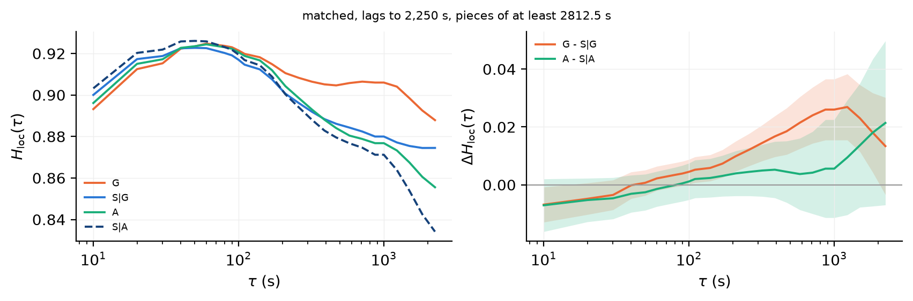
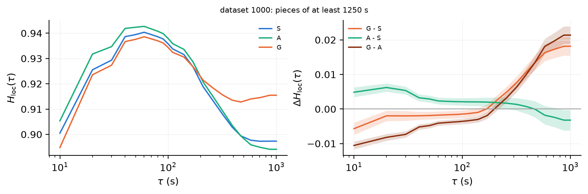
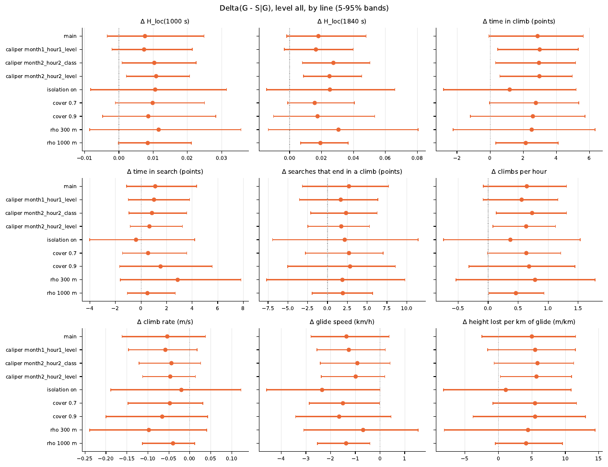
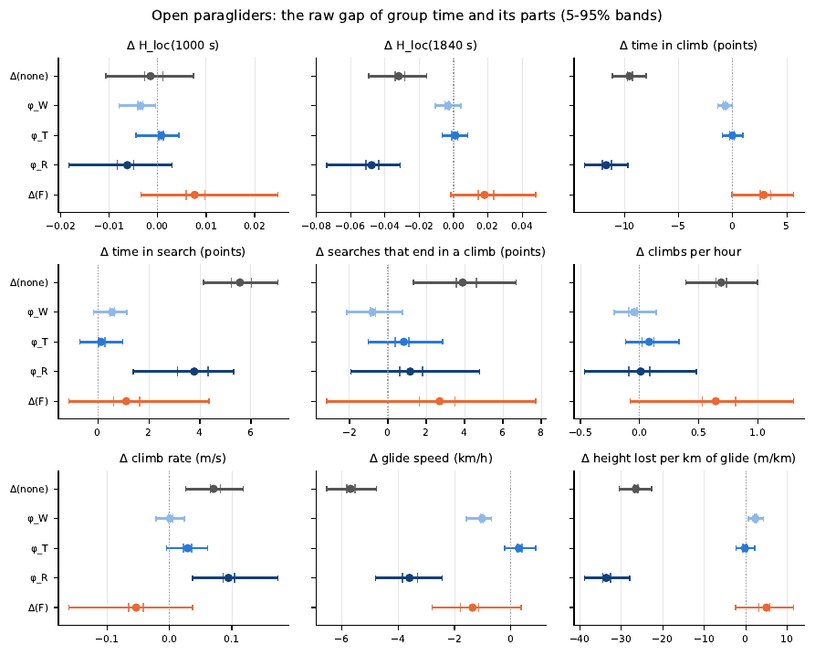
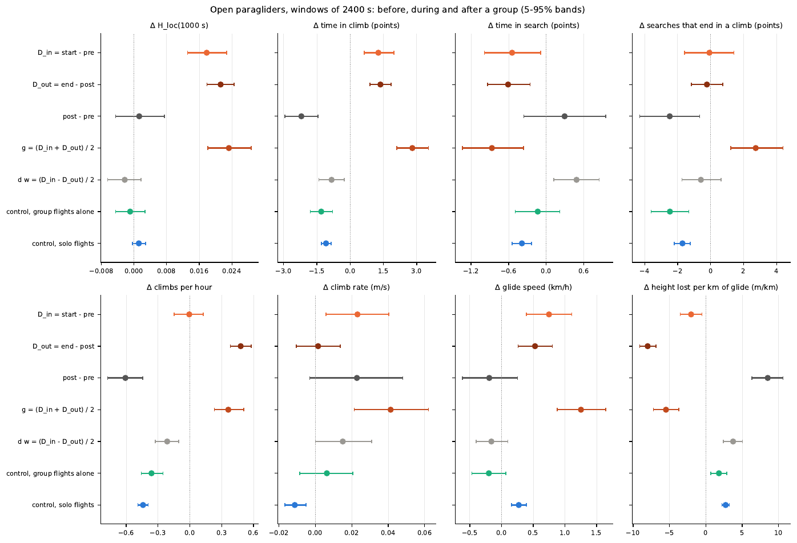

# Logbook · novembre 2026

## 2026-11-02 lun · gruppi, le incertezze dei confronti

- **Fatto:** revisione del report `comparisons` e del suo codice: io sul metodo delle incertezze, due agenti Opus in sola lettura sul codice e sul testo contro JSON e codice; ogni segnalazione verificata prima di correggere.
- **Fatto:** nuove bande per tutti e quattro i punti (`twoway.py`): tre bootstrap a una via di piloti, blocchi (episodi e sito-giorno) e celle pilota × blocco, V = max(V_p + V_b − V_c, V_p, V_b) (Cameron, Gelbach, Miller 2011), banda ±1.645 √V al 90%; pezzi e controlli estratti insieme. Spiegate nell'appendice H del report, con un esempio e la verifica.
- **Fatto:** `coverage.py`: valori sintetici (pilota + blocco + volo + unità, nessun effetto di gruppo) sui disegni reali dei punti 1, 2, 4. Bande nuove: copertura 88–99% del 90% nominale. Bande di prima: punto 2 troppo larghe (sd ×1.5–2.7, copertura 99–100%), punto 1 troppo strette se il pilota conta (59%).
- **Fatto:** correzioni dagli agenti: il punto 1 usava 200 estrazioni (non 1000) e solo gli episodi; la classe d'ala accettava "Biplace" e simili; centro dei pezzi spostato di 5 s; nel punto 4 D_in e D_out su eventi diversi da g e H_loc(1000 s) con finestra a due lati (ora tagliata a 1000 s come negli altri punti); T della serie lunga diverso tra G e A per livello; pool e cover mal descritti nel testo; segno perso a −0.000.
- **Fatto:** per ogni punto la figura tipo la 5 di `group_vs_solo.pdf`: H_loc(τ) accanto a ΔH_loc(τ) con banda (`*_delta`); le coppie MSD / H_loc in appendice.
- **Trovato:** grezzo, G − S a H_loc(1000 s) +0.018 [+0.015, +0.021], negativo ai lag brevi (−0.006 a 10 s), positivo da 170 s.
- **Trovato:** stessa rotta, stagione, ora, ala (1754 pezzi): ΔH_loc(1000 s) +0.007 [−0.000, +0.015], ma H_loc(1840 s) +0.018 [+0.004, +0.032] e H_loc(1000 s) sui pezzi del dataset 2250 +0.026 [+0.015, +0.037]; tempo in climb +2.9 [+1.3, +4.4], planata più lenta e più ripida. Selezione A − S|A dentro le bande per 8 su 9. Prima si leggeva "tutte le bande includono 0": era il metodo.

- **Trovato:** prima e dopo: g = +0.026 [+0.020, +0.032], sopra la banda del punto 2 sul dataset 1000, vicino al punto 2 sui pezzi lunghi. Decomposizione: la rotta porta Δ(∅) di H_loc(1840 s) (φ_R −0.048), φ_W ora fuori da 0 per planata e quota persa.

- **Non va:** velocità di planata e quota persa per km hanno segno opposto nei punti 2 e 4, ora con entrambe le bande lontane da 0. Le fasi tagliate dal bordo del volo contano come complete (qualche % delle fasi): non quantificato nel report. Il corpo resta di 13 pagine.
- **Prossimo:** lettura del report; capire il segno opposto della planata; decidere se H_loc(1000 s) sul dataset 1000 resta la misura principale o se passare ai pezzi più lunghi.
- **Rif.:** codice `02deac6`, `5d0c508`; report `group_vs_solo_comparisons @ 2c6db88` (23 pagine, 13 di corpo).

## 2026-11-02 lun · gruppi

- **Fatto:** piano del report `comparisons` in quattro confronti sui voli open (`analyses/groups/comparisons_plan.md`), eseguito nella notte da agenti Sonnet 5.5 (effort medium), un punto per sessione, ogni punto controllato prima del successivo: grezzo (`raw.py`), stessa rotta, stagione, ora e ala (`matched.py`), decomposizione di Shapley (`decomposition.py`), prima, durante e dopo il gruppo (`prepost.py --open --window 2400`). Report `group_vs_solo_comparisons @ a14a678`: 19 pagine, 13 di corpo e 6 di appendici, una per strumento.
- **Fatto:** nuovo stimatore delle statistiche delle fasi: per ogni unità (volo, pezzo, finestra) i tassi r = n/T e q = d/T, prima la media, poi il rapporto; ogni volo pesa uguale, come nell'MSD. La somma su tutto resta nel JSON come controllo.
- **Fatto:** `survival.py`, `prepost.py` e altri quattro script ignoravano `--open` (leggevano `flights.parquet`): corretti.
- **Fatto:** cancellati su SSD_DISANTE `runs_old_rule/` (8.7 GB) e le cache `analyses_open_6km`, `analyses_open_min0.5`: spazio libero da 2.2 a 11 GB.
- **Trovato:** grezzo: H_loc(1000 s) G 0.915, S 0.897, A 0.894; tempo in climb G 36.3%, S 32.9% (34.2% con la somma su tutto: lo stimatore conta).
- **Trovato:** stessa rotta, mese ±1, ora ±1, stessa classe d'ala (1763 pezzi, mediana 1 controllo per pezzo): ΔH_loc(1000 s) +0.008 [−0.003, +0.025], ΔH_loc(1840 s) +0.018 [−0.002, +0.048]; A contro i suoi controlli +0.003: selezione piccola. Tutte le bande includono 0. Robustezza (calibri larghi, isolamento, cover 0.7 e 0.9, ρ 300 e 1000 m): ΔH_loc(1000 s) tra +0.007 e +0.012.

- **Trovato:** Shapley a H_loc(1840 s): Δ(∅) −0.032, φ_R −0.048, φ_T +0.001, φ_W −0.003, Δ(F) +0.018. La rotta pesa, stagione e ora e ala quasi niente. Δ(∅) non coincide con il grezzo del punto 1: entrano solo i pezzi con un match di rotta, le finestre di controllo vengono da voli lunghi, l'unità è il pezzo. A 1000 s Δ(∅) ≈ 0 e le quote non hanno senso.

- **Trovato:** prima, durante e dopo, finestre di 2400 s: g = (D_in + D_out)/2 = +0.023 [+0.018, +0.029] a H_loc(1000 s), deriva d·w −0.002, post − pre +0.001, controlli ≈ 0. g sta nella banda del punto 2 ma è circa tre volte il suo valore centrale.

- **Non va:** i punti 2 e 4 hanno segno opposto per tempo in search, climb rate, velocità di planata e quota persa per km: da capire. Figura 11 del report: la legenda copre le curve di H_loc. Il corpo del report è di 13 pagine, sopra le 10.
- **Prossimo:** lettura del report; decidere se Δ(∅) va avvicinato al grezzo (controlli senza il vincolo di durata) o se basta spiegarlo; legenda della figura 11.
- **Rif.:** piano `f5238a3`; step 0 e punto 1 `ac731f0`..`adae534`; punto 4 `8feda48`..`e8e15b8`; punto 2 `5d6a320`..`3122a09`; punto 3 `eaa1fb5`, `dc95e24`; report `634cd88`, `bdf3508`, `a14a678`.
